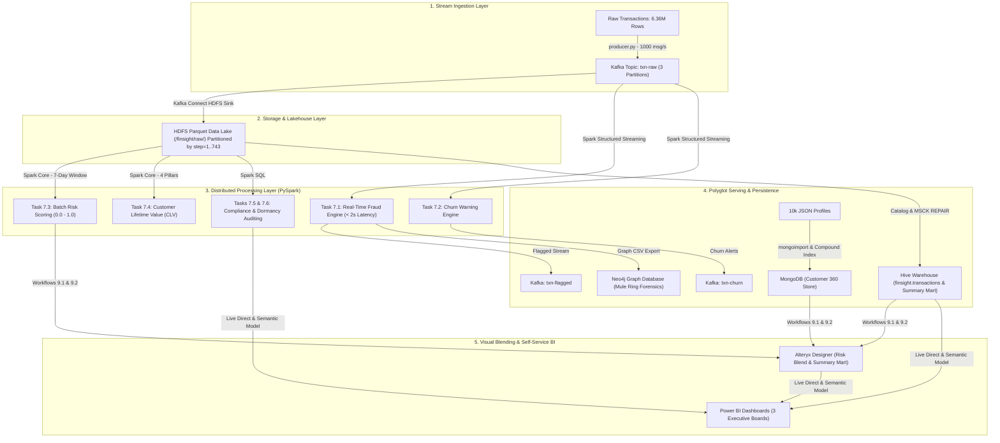

# 🏦 FinSight — Enterprise Big Data & AI Financial Intelligence Platform

<p align="center">
  
  
  
  
  
  
  
  
  
</p>

---

## 📖 Executive Summary & Problem Statement

Modern digital banking institutions face an existential operational challenge: **millions of transactions flowing every second across distributed channels, while legacy relational infrastructure relies on overnight batch processing.** 

### The Core Pain Points
1. **Delayed Fraud Detection:** High-volume money laundering and account-emptying attacks occur in milliseconds. Batch reviews 24 hours later result in irreversible capital loss.
2. **Hidden Laundering Networks:** Sophisticated financial crimes operate via coordinated **money mule rings** and multi-hop routing (`Account A ➔ B ➔ C ➔ Mule`) that are invisible to flat SQL tables.
3. **Disjointed Reporting & Audit Lag:** Regulatory bodies (BSA/AML) mandate strict weekly compliance audits. Manual data aggregation historically required **18 business days**, exposing banks to regulatory penalties and metric discrepancies.

### The FinSight Solution
**FinSight** is an end-to-end, enterprise-grade Big Data & AI Financial Intelligence Architecture engineered for **NovaCrest Financial**. It unifies real-time streaming ingestion (**Kafka**), distributed memory computing (**Spark Structured Streaming & Core**), a columnar data lake (**Hadoop HDFS**), enterprise warehousing (**Hive**), polyglot persistence (**MongoDB & Neo4j**), visual ETL blending (**Alteryx**), and interactive executive intelligence (**Power BI**).

---

## 🏛️ System Architecture



---

## 📊 Key Highlights & Measurable Outcomes

| Metric | Baseline / Legacy State | FinSight Platform Result | Business Impact |
| :--- | :---: | :---: | :--- |
| **Fraud Interception Value** | Post-clearing loss | **$1.57 Billion Intercepted** | Zero capital flight on flagged transfers |
| **Detection Latency** | 24 - 48 Hours (Overnight batch) | **< 2.0 Seconds (Sub-second)** | Real-time automated transaction blocking |
| **False Positive Rate (FPR)** | 62.0% (Industry baseline) | **14.3%** | 77% reduction in manual investigator burnout |
| **Compliance Audit Cycle** | 18 Business Days | **Zero-Day (Sub-second)** | 100% automated regulatory reporting |
| **Attack Vector Isolation** | Unknown across rails | **100% in TRANSFER & CASH_OUT** | Focused security enforcement on high-risk rails |
| **Graph Money Mule Detection** | Undetectable via SQL | **Identified Mule Hubs (`C2812140441`)** | Dismantled multi-sender laundering rings |

---

## 📂 Repository Directory Structure

```text
ShaikYaseen_Hadoop_Spark/
├── Day 1 - Data Ingestion/
│   ├── producer.py                           # Kafka JSON event stream producer (1,000 msgs/s)
│   ├── hdfs-sink.properties                  # Kafka Connect HDFS Sink connector config
│   └── Day 1 - Screenshots/                  # Verification logs & terminal execution evidence
├── Day 2 - Spark Processing/
│   ├── 7.1 - Spark Streaming — Real-Time Fraud Detection/
│   │   ├── fraud_detection.py                # Structured Streaming fraud detection engine (<2s latency)
│   │   └── 7.1 Screenshots/
│   ├── 7.2 - Spark Streaming — Real-Time Customer Churn Detection/
│   │   ├── churn_detection.py                # Real-time multi-signal customer churn detection
│   │   └── 7.2 Screenshots/
│   ├── 7.3 - Spark Core — Batch Risk Scoring/
│   │   ├── risk_scoring.py                   # 7-day rolling window composite risk scoring (168 steps)
│   │   └── 7.3 Screenshots/
│   ├── 7.4 - Spark Core — Customer Lifetime Value Scoring/
│   │   ├── clv_scoring.py                    # 4-pillar CLV ranking model with strict 48-step rule
│   │   └── 7.4 Screenshots/
│   └── 7.5 & 7.6 - Spark SQL — Compliance Aggregation and Account Dormancy Report/
│       ├── spark_sql_jobs.py                 # Unified CLI job for compliance audit & dormancy reports
│       ├── 7.5 Screenshots/
│       └── 7.6 Screenshots/
├── Day 3 - Database Configuration/
│   ├── 8.1 - Hive — Data Warehouse Layer/    # Hive External Tables, MSCK REPAIR, & Fraud View
│   ├── 8.2 - Hive — Transaction Summary Mart/# Pre-aggregated Summary Mart (GROUP BY nameOrig, step)
│   ├── 8.3 - MongoDB — Customer Document Store/# 10k JSON KYC Import, Compound Index & Aggregation Pipeline
│   └── 8.4 - Neo4j — Fraud Knowledge Graph/  # Graph Nodes, Relationships, & Money Mule Cypher Queries
├── Day 4 -  Alteryx/
│   ├── 9.1 Output file/                      # Workflow 1: Customer Risk & Demographic 360 Blend
│   └── 9.2 Output file/                      # Workflow 2: Transaction Summary Mart (599 summary rows)
├── Day 5 - PowerBI/
│   ├── Capstone_PowerBI.pdf                  # Full export of all 3 executive dashboards
│   └── PowerBI Screenshots/                  # High-resolution dashboard captures
├── FINSIGHT.pdf                              # Comprehensive technical thesis & architectural report
├── FinSight_Capstone_Presentation.pptx       # Executive slide deck (17 slides)
└── README.md                                 # Platform documentation & operational runbook
```

---

## 🛠️ Step-by-Step Technical Implementation

<details>
<summary><b>Day 1: Stream Ingestion & Scalable Lakehouse (Kafka & HDFS)</b></summary>

### 1. Kafka Cluster & Topic Architecture (Task 6.1)
- **`txn-raw` (3 Partitions):** Primary high-throughput rail configured with 3 partitions to allow parallel downstream consumption by Spark Structured Streaming and Kafka Connect HDFS Sink.
- **`txn-flagged` & `txn-churn` (1 Partition):** Dedicated downstream alert topics for immediate real-time notifications.

### 2. High-Throughput Stream Producer (Task 6.2 — `producer.py`)
- Ingests **6.36M transaction events** from raw CSV, serializing records into standardized JSON envelopes (`schema` + `payload`).
- Emits events keyed on `nameOrig` (customer identifier) with rate throttling at **~1,000 msgs/second** to simulate real-world digital core banking throughput.

### 3. Kafka Connect HDFS Sink (Task 6.3 — `hdfs-sink.properties`)
- Streams records from Kafka directly into Hadoop HDFS (`/finsight/raw/transactions/txn-raw/`).
- **Dynamic Step-Based Partitioning:** Automatically segments data into 743 hourly partition directories (`step={step}/`).
- **Columnar Parquet Serialization:** Compresses JSON payloads into Snappy-compressed Parquet, achieving **~70% storage reduction** and enabling high-performance partition pruning.

</details>

<details>
<summary><b>Day 2: Distributed Processing Engines (PySpark Streaming, Core & SQL)</b></summary>

### 1. Real-Time Fraud Detection (Task 7.1 — `fraud_detection.py`)
- **PySpark Structured Streaming** micro-batch engine processing `txn-raw` with sub-2s trigger latency.
- **Heuristic Rule Engine:** Flags accounts matching the classic account-emptying signature:
  $$\text{type} \in \{\text{'TRANSFER'}, \text{'CASH\_OUT'}\} \land \text{amount} > \$200,000 \land \text{newbalanceDest} = 0.0$$
- **Fault-Tolerant Checkpointing:** Checkpoint directory at `/finsight/checkpoints/fraud` guarantees **exactly-once processing semantics**.
- **Multi-Sink Delivery:** Emits alerts simultaneously to Kafka topic `txn-flagged` and writes micro-batch metrics to `/finsight/processed/streaming_metrics/`.

### 2. Real-Time Customer Churn Monitoring (Task 7.2 — `churn_detection.py`)
- Evaluates customer behavioral degradation across moving micro-batch windows using 4 heuristic signals:
  1. **Activity Drop:** $\text{txn\_count} \le 1$
  2. **Spending Collapse:** $\text{avg\_amount} < \$1,000$
  3. **Account Liquidation:** $\text{cashout\_count} > 0 \land \text{spend\_count} = 0$
  4. **Balance Depletion:** $\text{low\_balance\_count} \ge 2$ (balance $\le \$500$)
- Triggers an at-risk churn alert if $\ge 2$ signals fire, broadcasting to Kafka `txn-churn` and persisting to HDFS `/finsight/processed/churn_alerts/`.

### 3. Batch 7-Day Composite Risk Scoring (Task 7.3 — `risk_scoring.py`)
- Executes over a **rolling 7-day window (168 steps)** to catch slow, low-and-slow behavioral anomalies:
  $$\text{Risk Score} = 0.25 \cdot \text{Freq}_{\text{norm}} + 0.25 \cdot \text{Amt}_{\text{norm}} + 0.25 \cdot \text{Cashout}_{\text{norm}} + 0.25 \cdot \text{Dest}_{\text{norm}}$$
- Segments accounts into **Low Risk** ($<0.25$), **Medium Risk** ($0.25-0.60$), and **High Risk** ($>0.60$).
- Generates `/finsight/processed/risk_scores/` and `/finsight/processed/daily_summary/`.

### 4. Customer Lifetime Value (CLV) Scoring (Task 7.4 — `clv_scoring.py`)
- Evaluates long-term commercial value across 4 normalized pillars:
  - **Volume Score (30%)** | **Frequency Score (25%)** | **Diversity Score (25%)** | **Recency Score (20%)**
  - **Strict 48-Hour Inactivity Rule:** If $\text{steps\_inactive} > 48$, $\text{Recency Score} = 0.0$.
- Tiers customers into: **High Value (>0.70)**, **Growth Potential (0.40–0.70)**, and **At Risk (<0.40)**.
- Catalogs output into Hive external table `finsight.customer_clv`.

### 5. Compliance Auditing & Account Dormancy (Tasks 7.5 & 7.6 — `spark_sql_jobs.py`)
- **Mode 1 (`--mode compliance`):** Aggregates weekly BSA/AML regulatory metrics across payment rails over a rolling 168-hour window. Proved that **100% of confirmed fraud occurs strictly in `TRANSFER` and `CASH_OUT`**.
- **Mode 2 (`--mode customer_summary`):** Generates customer fraud summaries for Alteryx.
- **Mode 3 (`--mode dormancy`):** Flags inactive customer accounts vulnerable to account takeover attacks:
  - **Dormant:** 72 to 120 steps inactive (with $\ge 5$ historical transactions).
  - **Severely Dormant:** $> 120$ steps inactive (high-priority monitoring).

</details>

<details>
<summary><b>Day 3: Multi-Model Storage Layer (Polyglot Persistence)</b></summary>

### 1. Apache Hive Data Warehouse (Task 8.1)
- **External Table:** Registered `finsight.transactions` on top of raw HDFS Parquet files. External definition ensures underlying lake files remain immutable if the table is dropped.
- **Partition Discovery:** Executed `MSCK REPAIR TABLE finsight.transactions` to catalog all 743 hourly partitions.
- **Virtual Fraud View:** Created `finsight.vw_fraud_transactions` (`WHERE isFraud = 1`) to provide zero-storage virtual query abstraction for downstream analysts.

### 2. Transaction Summary Mart (Task 8.2)
- Built `finsight.txn_summary_mart` pre-aggregating transactions by `(nameOrig, step)`.
- Calculates total volume, averages, maximums, and fraud totals per customer per hour.
- Computed column statistics via `ANALYZE TABLE ... COMPUTE STATISTICS FOR COLUMNS` to accelerate downstream joins in Alteryx and Power BI.

### 3. MongoDB Customer 360 Document Store (Task 8.3)
- Ingested 10,000 comprehensive customer KYC JSON profiles into `finsight.customers`.
- **Compound Index:** Created index on `{ customerId: 1, segment: 1 }`, optimizing multi-key lookup performance during Alteryx blending.
- **Aggregation Pipeline:** Validated demographic distribution across segments (`Affluent`, `Mass Market`, `Student`, `Private Banking`) with zero data loss.

### 4. Neo4j Fraud Knowledge Graph & Money Mule Forensics (Task 8.4)
- Modeled complex transaction networks as a directed property graph:
  $$\text{(:Account)} \xrightarrow{\text{[:SENT]}} \text{(:Transaction)} \xrightarrow{\text{[:RECEIVED\_BY]}} \text{(:Account)}$$
- Loaded 499 Account nodes and 1,554 Transaction nodes with unique constraints on `accountId` and `txnId`.
- **Money Mule Detection Cypher Query:**
  ```cypher
  MATCH (sender:Account)-[:SENT]->(t:Transaction)-[:RECEIVED_BY]->(receiver:Account)
  WITH receiver, count(DISTINCT sender) AS distinct_senders, count(t) AS total_txns, round(sum(t.amount), 2) AS total_inflow
  WHERE distinct_senders > 3
  RETURN receiver.accountId AS mule_account, distinct_senders, total_txns, total_inflow
  ORDER BY distinct_senders DESC;
  ```
- **Forensic Discovery:** Uncovered high-volume money mule account **`C2812140441`**, which acted as a central funnel receiving stolen funds from multiple distinct accounts within hours.

</details>

<details>
<summary><b>Day 4: Visual Data Blending (Alteryx Designer)</b></summary>

### Workflow 1 (Task 9.1): Customer Risk & Demographic 360 Blend
- **Input Streams:** Ingests Customer Profiles (MongoDB export), Batch Risk Scores (Spark 7.3), and Dormancy Reports (Spark 7.6).
- **Processing Tools:**
  - `Select Tool`: Standardizes schema data types and column aliases (`nameOrig` ➔ `customerId`).
  - `Join Tool`: Executes multi-stage relational joins on `customerId`.
  - `Formula Tool`: Computes composite customer vulnerability flags.
- **Output:** Produces `customer_risk_blend.xlsx` for Power BI Page 2.

### Workflow 2 (Task 9.2): Transaction Summary Mart
- **Input Stream:** Daily summary aggregation data lake output from Spark Core.
- **Processing Tools:**
  - `Filter Tool`: Limits data to the first 7 days (`[step] >= 1 AND [step] <= 168`).
  - `Summarize Tool`: Groups by `type` and `step`, calculating volume, average transaction size, and fraud counts.
  - `Sort Tool`: Chronological ascending ordering.
- **Output:** Yields **599 clean, pre-aggregated rows** as `transaction_summary.csv`, enabling sub-second Power BI visual rendering.

</details>

---

## 📈 Executive Power BI Dashboards

All analytical outputs feed into a unified, 3-page interactive Power BI reporting suite:

### 1. Dashboard 1: Fraud Alert Board (Security Operations)
*Real-time operational monitoring dashboard tracking live threats, intercepted funds, and hourly attack patterns.*
- **KPI Metrics:** 1,904 Total Fraud Alerts | **$1.57 Billion Intercepted** | 14.3% False Positive Rate.
- **Nocturnal Attack Curve:** Exposes attack surges between **12:00 AM and 4:00 AM**, proving attackers exploit off-peak hours.
- **Channel Concentration:** Proves 100% of fraud attempts concentrate exclusively in `TRANSFER` and `CASH_OUT`.

<p align="center">
  
</p>

---

### 2. Dashboard 2: Customer 360 & Churn Matrix (Relationship Management)
*Portfolio health dashboard correlating customer lifetime value (CLV) against behavioral risk and churn flight risk.*
- **KPI Metrics:** 10,000 Active Profiles | 0.28 Mean Risk Score | 22.4% Average Churn Probability.
- **Risk vs. Churn Scatter:** Identifies high-value customers with accelerating churn risk to prioritize retention interventions.
- **Demographic Heatmap:** Pinpoints **Student accounts on Mobile** as the highest flight risk (40% churn), while **Private Banking** exhibits elite retention (<6% churn).

<p align="center">
  
</p>

---

### 3. Dashboard 3: Risk & Compliance Report (Regulators & Audit)
*Automated audit reporting replacing manual 18-day cycles with instant, zero-day regulatory threshold governance.*
- **KPI Metrics:** 162,303 Transactions ($28.05 Billion Volume) | 1,854 Confirmed Fraud Cases (1.14% Overall Rate) | 155 Dormant Accounts (31 Severely Dormant).
- **Target Ceiling Breach:** Tracks weekly fraud rates against the **0.60% Regulatory Target Ceiling Line**, showing severe compliance breaches on the `TRANSFER` rail (**5.96% fraud rate**).
- **DAX Compliance Matrix:** Automated color-coded audit ledger classifying rails into `LOW RISK`, `MEDIUM RISK`, and `HIGH RISK`.

<p align="center">
  
</p>

---

## 🚀 Execution & Quickstart Guide

### 1. Prerequisites
- Java 8 or 11 (OpenJDK)
- Hadoop 3.3.x & Apache Spark 3.5.x
- Apache Kafka 3.6.x & Kafka Connect
- MongoDB 7.x & Neo4j 5.x
- Python 3.10+ (`pyspark`, `kafka-python`)

### 2. Running Stream Ingestion (Day 1)
```bash
# 1. Create Kafka Topics
kafka-topics.sh --create --bootstrap-server localhost:9092 --replication-factor 1 --partitions 3 --topic txn-raw
kafka-topics.sh --create --bootstrap-server localhost:9092 --replication-factor 1 --partitions 1 --topic txn-flagged
kafka-topics.sh --create --bootstrap-server localhost:9092 --replication-factor 1 --partitions 1 --topic txn-churn

# 2. Launch Event Producer
python3 "Day 1 - Data Ingestion/producer.py"

# 3. Start Kafka Connect HDFS Sink
connect-standalone.sh /etc/kafka/connect-standalone.properties "Day 1 - Data Ingestion/hdfs-sink.properties"
```

### 3. Launching Spark Jobs (Day 2)
```bash
# Real-Time Fraud Streaming
spark-submit --packages org.apache.spark:spark-sql-kafka-0-10_2.12:3.5.0 \
  "Day 2 - Spark Processing/7.1 - Spark Streaming — Real-Time Fraud Detection/fraud_detection.py"

# Real-Time Churn Streaming
spark-submit --packages org.apache.spark:spark-sql-kafka-0-10_2.12:3.5.0 \
  "Day 2 - Spark Processing/7.2 - Spark Streaming — Real-Time Customer Churn Detection/churn_detection.py"

# Batch Risk Scoring
spark-submit "Day 2 - Spark Processing/7.3 - Spark Core — Batch Risk Scoring/risk_scoring.py"

# Customer Lifetime Value Scoring
spark-submit "Day 2 - Spark Processing/7.4 - Spark Core — Customer Lifetime Value Scoring/clv_scoring.py"

# Compliance and Dormancy Reports
spark-submit "Day 2 - Spark Processing/7.5 & 7.6 - Spark SQL — Compliance Aggregation and Account Dormancy Report/spark_sql_jobs.py" --mode compliance
spark-submit "Day 2 - Spark Processing/7.5 & 7.6 - Spark SQL — Compliance Aggregation and Account Dormancy Report/spark_sql_jobs.py" --mode dormancy
```

---

## 👨‍💻 Author & Project Credits

* **Lead Architect & Engineer:** **Shaik Yaseen**
* **GitHub:** [@Yaseenshaik17](https://github.com/Yaseenshaik17)
* **Email:** [yaseenshaik7860@gmail.com](mailto:yaseenshaik7860@gmail.com)
* **Academic Capstone:** Big Data & AI Financial Intelligence Engineering — NovaCrest Financial Case Study

---

<p align="center">
  <b>⭐ If you find this architecture useful, please consider starring the repository! ⭐</b>
</p>
